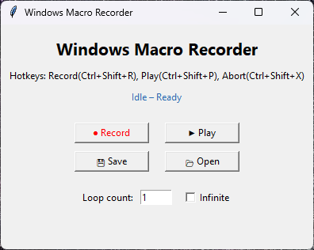

# Macro Recorder

[](https://github.com/SparkerData/Macro-Recorder/releases/latest)
[](https://github.com/SparkerData/Macro-Recorder/actions/workflows/ci.yml)
[](LICENSE)

[](https://github.com/SparkerData/Macro-Recorder/releases/latest)

A clean, cross-platform macro recorder and player for keyboard & mouse, built with Tkinter and `pynput`.

## Features
- Record keyboard and mouse events with precise timing
- Play back once, N loops, or infinitely
- Global Abort hotkey (Ctrl + Shift + X) to stop playback immediately
- Toggleable “Infinite Loop” checkbox + numeric loop count
- Save/load macros to JSON
- Minimal, responsive UI (Tkinter)
- Windows/macOS/Linux (requires Tk on Linux)

## Demo
> Replace the placeholder by adding `assets/demo.gif` to show the UI in action.


## Quickstart

```bash
# 1) Create a virtual environment
python -m venv .venv

# 2) Activate it
# Windows:
.venv\Scripts\activate
# macOS/Linux:
# . .venv/bin/activate

# 3) Install
pip install -r requirements.txt

# 4) Run
python -m macrorecorder
# or
macrorecorder
```

> On Linux, install Tk: `sudo apt-get install python3-tk`

## Packaging (Optional)

You can build a single-file executable (e.g., for Windows) with PyInstaller:

```bash
python -m PyInstaller --onefile --windowed --name MacroRecorder src/macrorecorder/app.py
```

The output will be in `dist/`.

## Development

```bash
pip install -r requirements.txt
pip install -e .
pip install pytest ruff

# Lint / format
ruff check .
ruff format .

# Tests
pytest -q
```

## Project Structure

```text
Macro-Recorder/
├─ src/macrorecorder/
│  ├─ __init__.py
│  ├─ __main__.py
│  └─ app.py
├─ assets/                # demo.gif (screenshot/GIF)
├─ examples/              # sample macro JSONs
├─ tests/
├─ .github/workflows/
│  └─ ci.yml
├─ scripts/
│  └─ build_exe_windows.ps1
├─ pyproject.toml
├─ requirements.txt
├─ README.md
├─ LICENSE
├─ .gitignore
├─ .pre-commit-config.yaml
└─ ruff.toml
```

## Notes
- This repository packages the app as an installable module with a CLI entrypoint.
- Entry point `macrorecorder` launches the GUI.
- JSON macro files are human-readable for easy sharing via GitHub.
- On Linux, make sure Tk is installed (`python3-tk`).

## Examples

Try the sample macros in the `examples/` folder:
- `examples/sample_click_and_type.json`
- `examples/sample_loop_scroll.json`

Use **Load** in the app to open a JSON and **Play** to run it.

## Continuous Integration

This repo uses GitHub Actions (`.github/workflows/ci.yml`) to lint and test on every push/PR.
Add the CI badge at the top of the README to see status at a glance.


